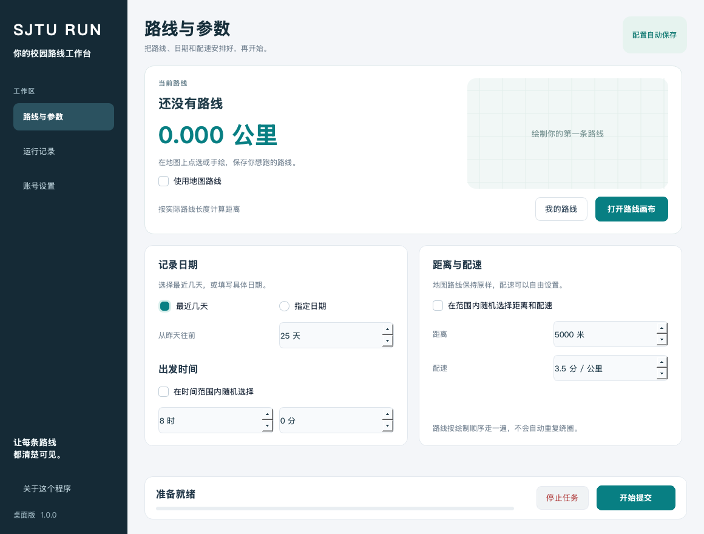

# SJTU RUN · 路线工作台 1.0.0

基于 [Gnonymous/SJTURunning](https://github.com/Gnonymous/SJTURunning) 整理的独立桌面版本，采用 Python 与 PySide6，保留上游 MIT 许可证。



## 功能

- 浅色工作台：统一管理账号、日期、配速、路线及运行日志。
- 地图路线编辑：点选、手绘、撤销、缩放与触控板平移。
- 地图切换：OpenStreetMap 无需密钥；高德地图需自行配置 JS API Key 与安全密钥。
- 本地路线库：保存、重命名、导入、导出和再次调用，原子写入保护已有数据。
- 坐标转换：路线保存和导出使用 WGS84，高德显示及相关接口边界进行 GCJ-02 转换。
- 保留上游登录、参数配置、轨迹采样和提交功能。接口响应成功不等同于学校认定有效成绩。

## Web 版

手机与电脑可打开 [Web 路线工作台](https://yichenbert.github.io/SJTURunning/)，直接绘制、管理和导出路线。登录与提交需连接你部署的 Python 服务，GitHub Pages 本身仅托管前端。详见 [Web 版说明](web/README.md)。

## 下载与运行

从 [Releases](https://github.com/yichenbert/SJTURunning/releases/latest) 下载对应平台的安装包，解压后运行。macOS 包面向 Apple Silicon（arm64），采用本地 ad-hoc 签名，未经 Apple 公证。Windows 包由 GitHub Actions 构建，发布页有对应附件时才表示可下载。

源码运行（Python 3.11）：

```sh
python -m venv .venv
# macOS / Linux
source .venv/bin/activate
# Windows PowerShell 使用 .venv\Scripts\Activate.ps1
pip install -r requirements.txt
python qtui.py
```

地图使用说明见 [地图路线使用说明](packaging/地图路线使用说明.md)、[高德配置](packaging/高德地图接入说明.md) 和 [路线库说明](packaging/坐标修正与路线库说明.md)。

## 隐私与配置

账号密码不会写入配置文件。高德密钥单独保存于本机地图设置文件，不随源码和安装包提供。路线、地图设置、缓存及旧安装包均不纳入版本提交。

源码运行时配置位于项目目录；打包版位于 macOS 的 `~/Library/Application Support/SJTURunning` 或 Windows 的 `%APPDATA%\SJTURunning`。验证码识别沿用上游第三方服务，详细行为可查看 `src/login.py`。

## 验证与构建

```sh
python -m unittest discover -s tests -v
pip install pyinstaller
python -m PyInstaller --noconfirm --clean packaging/SJTURunning.spec
```

本地 43 项离线单元与 GUI 事件测试通过。测试涉及坐标转换、路线采样、地图交互、配置和路线库；未验证真实账号登录、真实提交、高德在线鉴权或成绩认定。详见 [验证结果](packaging/验证结果.md)。macOS 本机重建可运行 `packaging/build-macos.sh`。

## 源码参考与作者

根据上游 README 的作者署名：

- 原作者：[Labyrinth0419](https://github.com/Labyrinth0419)
- 二改优化：[accelerator-s](https://github.com/accelerator-s)
- 三改维护及本版直接参考仓库：[Gnonymous](https://github.com/Gnonymous) / [SJTURunning](https://github.com/Gnonymous/SJTURunning)
- 本版整理与发布：[yichenbert](https://github.com/yichenbert)

参考基础提交：`9938d0d58569eaa3a9c3ede8bb85780bf73140de`（上游 2.1.1）。本仓库将本地界面与地图改动整合为独立发行版 **1.0.0**，版本序列与上游分别维护。

采用 [MIT License](LICENSE)，保留原许可证的 Copyright (c) 2025 Yuhan Guo丨Eohan。请遵守学校及服务平台的相关规定。
